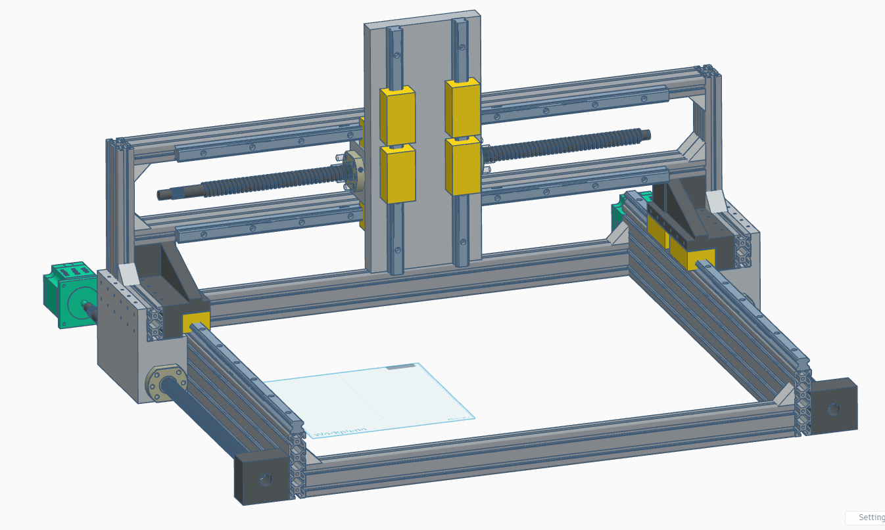

# 3AxisCNC

  

  
  
  
  

A DIY 3-axis CNC machine built by a student.

> **Status:** Work in progress. Funding from Hack Club is pending (not yet approved).

The machine can cut aluminum, wood, acrylic and other similar materials with great accuracy.
Controlled by GRBL + UGS.

  

## Specifications

| Item | Details |
|------|---------|
| Work area | 450 x 350 mm |
| Motors | NEMA 23, 2.3 Nm, 8 mm shaft |
| Drivers | DM542 |
| Controller | Arduino UNO + CNC shield A4988 |
| Frame | 2040 / 2080 aluminium extrusions: 100, 200, 600, 700 mm |
| Linear motion (screws) | SFU1605 ball screws: 300, 500, 600 mm |
| Linear motion (rails) | HGR15 rails + 2 HGH15CA carriages: 300, 600 mm |
| Mounting hardware | M4 steel slider nuts, M4 hex screws, corner brackets, 3D printed parts |
| 3D printer used | Creality Ender 3 V2 |

## Bill of Materials / Price List

Prices are in CZK. These are not final prices, shipping is expected to cost around 4,000 CZK.

| Item | Pieces | Price per set/pc | Total |
|------|-------:|-----------------:|------:|
| 2080 600 mm T-slot | 2 | 200 | 400 |
| 2040 600 mm T-slot | 2 | 80 | 160 |
| 2040 700 mm T-slot | 2 | 100 | 200 |
| 2040 200 mm T-slot | 2 | 50 | 100 |
| 2040 100 mm T-slot | 2 | 40 | 80 |
| SFU1605 500 mm | 2 | 94.74 | 189.48 |
| SFU1605 600 mm | 1 | 113.60 | 113.60 |
| SFU1605 300 mm | 1 | 56.80 | 56.80 |
| HGR15 + 2 HGH15CA 600 mm | 4 | 136.32 | 545.28 |
| HGR15 + 2 HGH15CA 300 mm | 2 | 68.16 | 136.32 |
| NEMA 23 2.3 Nm + DM542 | 4 | 488.48 | 1,953.92 |
| Coupler 8-10 mm | 4 | 61.34 | 245.38 |
| BKBF12 end bearing | 4 | 102.24 | 408.96 |
| BKBF12 bearing | 4 | 189.26 | 757.03 |
| SFU1605 screw nut | 4 | 165.86 | 663.42 |
| Vacuum mount | 1 | 150 | 150 |
| **Total** | | | **6,160.20 CZK** |

## Roadmap

- [x] Finish CAD
- [ ] Get funding
- [ ] Order parts
- [ ] Assemble machine
- [ ] Configure GRBL
- [ ] First cut

